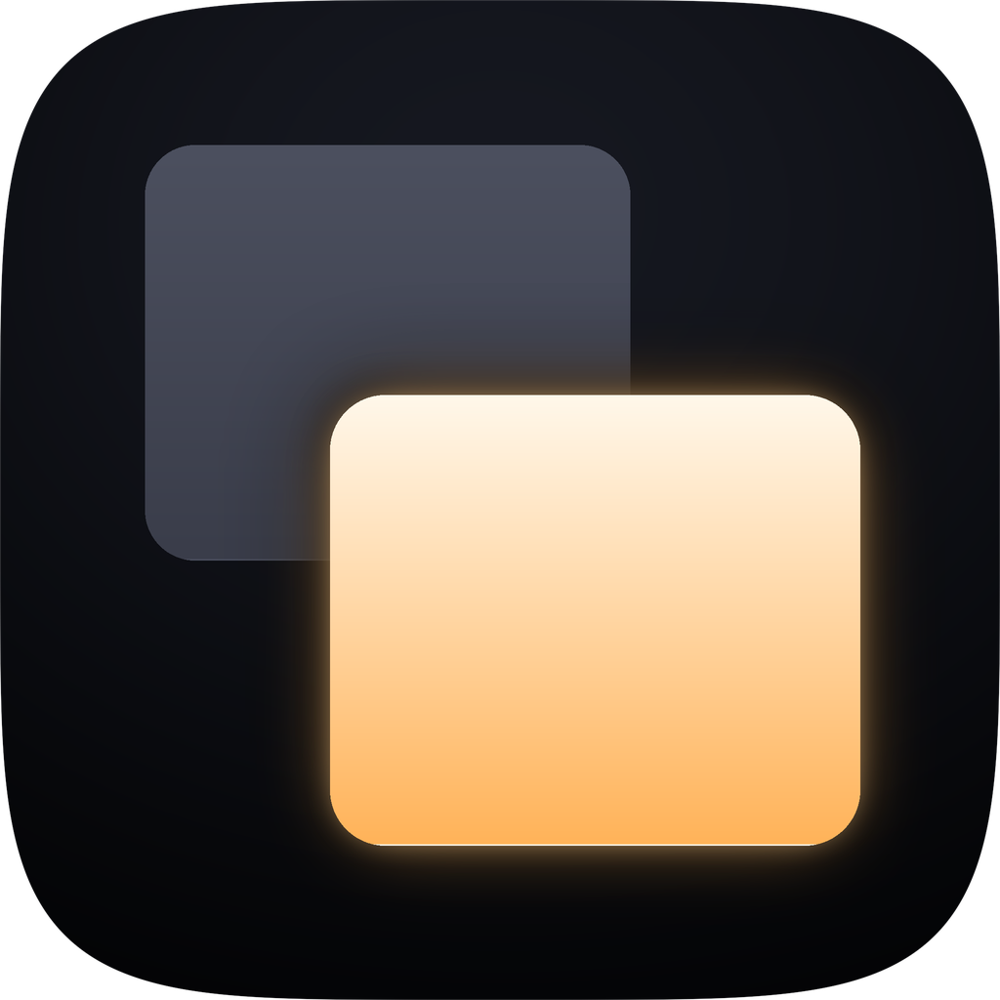

# Vignette

<p align="center">
  
</p>

**Vignette**는 여러 대의 모니터를 쓰는 환경을 위한 macOS 메뉴바 앱입니다. Dock
아이콘 없이 메뉴바에만 상주하며, 디스플레이별 밝기 조절과 "영화 감상 모드"
두 가지를 제공합니다.

## 주요 기능

- **디스플레이별 밝기 조절** — 내장 디스플레이는 물론 외장 모니터까지,
  연결된 모든 화면마다 독립적인 밝기 슬라이더를 메뉴바에서 바로 조작할 수
  있습니다.
- **영화 감상 모드** — 지금 영상이 재생되고 있는 화면 하나를 고르면, 나머지
  모든 화면에 어두운 그라데이션 오버레이가 깔려 자연스럽게 시선이 분산되는
  걸 막아줍니다. 끄면 즉시 원래대로 돌아옵니다.
- **가능한 경우 실제 백라이트까지 제어** — 내장 패널이나 DDC/CI를 지원하는
  외장 모니터처럼 실제로 밝기 제어가 가능한 화면에서는, 화면 위에 오버레이만
  덧씌우는 게 아니라 진짜 백라이트 밝기 자체를 낮춥니다. 지원하지 않는
  환경에서는 소프트웨어 오버레이로 자동 대체되므로, 밝기 슬라이더는 어떤
  모니터에서든 항상 눈에 보이는 효과를 냅니다.
- **한국어 · English · 日本語** 지원.

## 요구 사항

- macOS 13 Ventura 이상
- Apple Silicon 또는 Intel Mac

## 설치

```sh
brew tap mrKangHo/vignette https://github.com/mrKangHo/vignette
brew install --cask vignette
```

또는 [Releases](https://github.com/mrKangHo/vignette/releases) 페이지에서
DMG를 받아 직접 설치할 수 있습니다. Developer ID로 서명되지 않은 빌드이므로
처음 실행할 때 Gatekeeper 경고가 뜰 수 있습니다 — 저장소 README의 안내를
참고하세요.

## 왜 비공개 API를 쓰나요

macOS에는 디스플레이 백라이트를 제어하는 공식 API가 없습니다 (내장 패널,
외장 모니터 DDC/CI 모두 마찬가지입니다). Vignette는 macOS Control Center나
MonitorControl, Lunar 같은 도구들이 쓰는 것과 동일한, 비공개·비공식
메커니즘을 `dlopen`/`dlsym`으로 런타임에 동적으로 찾아서 사용합니다. 그래서:

- Mac App Store로는 배포할 수 없고, Developer ID 서명/공증을 통한 배포만
  가능합니다.
- 외장 모니터의 밝기 제어(DDC/CI)는 모니터·케이블·허브 조합에 따라 동작하지
  않을 수 있는 best-effort 기능입니다. 이 경우에도 소프트웨어 오버레이는
  항상 동작합니다.

## 라이선스

[MIT](../LICENSE)
